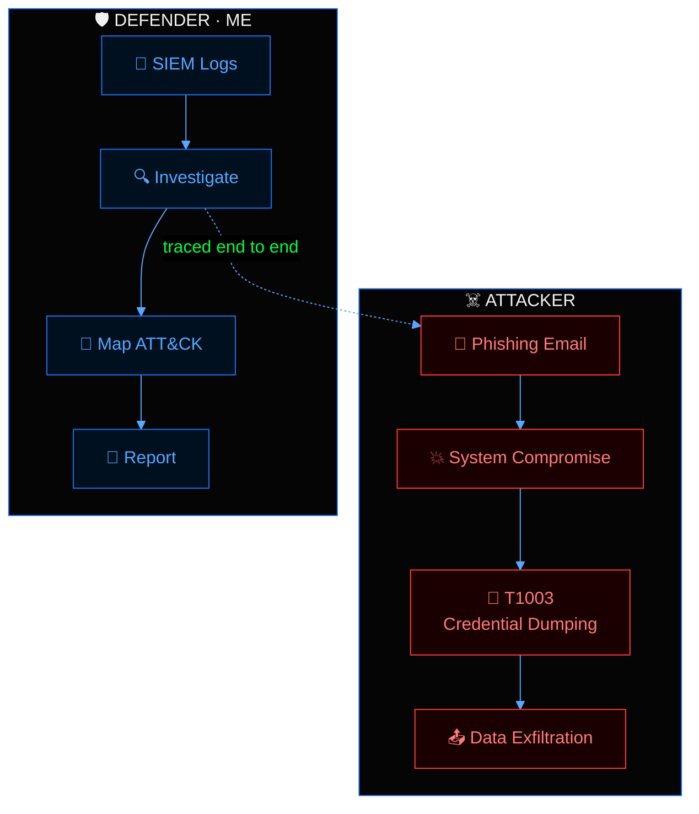

```mermaid
%%{init: {'theme':'base','themeVariables':{'primaryColor':'#000000','primaryTextColor':'#00ff41','primaryBorderColor':'#00ff41','lineColor':'#58a6ff','fontFamily':'monospace'}}}%%
flowchart LR
    A["[DONE]<br/>Cisco & IBM<br/>Foundations"] --> B["[DONE]<br/>Fortinet NSE 3<br/>Huawei Net Sec"]
    B --> C["[DONE]<br/>Cisco Defense<br/>Analyst Pathway"]
    C --> D["[DONE]<br/>TryHackMe Top 1%<br/>SOC Sim · Splunk"]
    D --> E["[RUNNING]<br/>Microsoft<br/>Sentinel"]
    E --> F["[RUNNING]<br/>Active Directory<br/>Lab"]
    F --> G["[RUNNING]<br/>Sysmon +<br/>Detection Eng."]
    G --> H["[GOAL]<br/>SOC Analyst /<br/>Threat Hunter"]
    classDef done fill:#000000,stroke:#00ff41,color:#00ff41
    classDef run fill:#00101f,stroke:#1f6feb,color:#58a6ff,stroke-dasharray: 4 3
    classDef goal fill:#00ff41,stroke:#1f6feb,color:#000000
    class A,B,C,D done
    class E,F,G run
    class H goal
```

<div align="center">


<br/>

<a href="https://tryhackme.com/p/ENGZOOZ"></a>
<a href="https://www.linkedin.com/in/engzooz/"></a>
<a href="mailto:ziad.ayman.shokry@gmail.com"></a>


</div>

```text
╔════════════════════════════════════════════════════════════════╗
║  ziad@soc-terminal  ::  BLUE TEAM  ::  DEFENSIVE SECURITY      ║
║  session: ACTIVE   |   shield: ENABLED   |   alerts: TRIAGED   ║
╚════════════════════════════════════════════════════════════════╝
```


```bash
$ whoami
ziad.ayman

$ cat profile.txt
name       : Ziad Ayman
education  : B.Sc. Computer Science, Minya National University (class of 2028)
role       : Aspiring SOC Analyst / Blue Team
looking_for: SOC Analyst / Cybersecurity internship
rank       : Top 1% worldwide on TryHackMe
building   : Microsoft Sentinel | Active Directory Lab | Sysmon & Detection Eng.
creed      : "Document everything. Prove everything. Automate the rest."
```

> 🟢 I don't just collect certificates. I build proof: hands-on labs, documented investigations and real SOC simulations that show *how* I think, not just *what* I studied.


```text
┌──────────────────── SOC PERFORMANCE ────────────────────┐
  ALERTS CLOSED    90                  (5 full scenarios)
  TRUE POSITIVE    [██████████████████████] 100%
  MTTR             1 min               (platform avg: 4 min)
  DWELL TIME       9 min               (Phishing Unfolding)
└─────────────────────────────────────────────────────────┘
┌──────────────────── TRAINING & SKILLS ──────────────────┐
  TRYHACKME        Top 1%  |  200+ rooms  |  30+ badges
  OVERTHEWIRE      Bandit 34/34 levels
  PROBLEMS SOLVED  2,300+ (Codeforces / HackerRank)
  CERTIFICATIONS   10+
└─────────────────────────────────────────────────────────┘
```


```text
 alert ──▶ triage ──▶ investigate ──▶ map to ATT&CK ──▶ report
                      (Splunk · Wireshark · VirusTotal · CyberChef)
                                                        (timeline · IOCs · fixes)
```

<table width="100%">
<tr>
<td width="33%" valign="top">

### 🔵 Detect
- Alert triage & prioritization
- Brute-force & SYN/FIN scan detection
- Suspicious DNS / DNS tunneling analysis
- HTTP credential exposure detection

</td>
<td width="33%" valign="top">

### 🟢 Analyze
- Splunk SPL, dashboards & correlation
- Deep packet inspection (Wireshark)
- Nmap: OS fingerprinting, NSE, stealth scans
- VirusTotal · CyberChef · Event Viewer

</td>
<td width="33%" valign="top">

### 🔵 Respond & Report
- End-to-end phishing investigation
- MITRE ATT&CK technique mapping
- Attack timelines & IOC extraction
- Remediation recommendations

</td>
</tr>
</table>


### 📁 phishing_unfolding / case file



```text
CASE        : Phishing Unfolding (TryHackMe SOC Simulator)
ALERTS      : 35 closed | 100% true positive
DWELL TIME  : 9 min
TECHNIQUE   : T1003 - Credential Dumping (primary)
DELIVERABLE : timeline · IOCs · MITRE ATT&CK mapping · remediation
```

<table width="100%">
<tr>
<td width="50%" valign="top">

### 🕵️ soc_simulator/
5 full SOC scenarios, end to end.

- **90 alerts** triaged, **100% true positive**
- **1-min MTTR** (platform avg: 4 min)
- Findings mapped to **MITRE ATT&CK**

`Alert Triage` `Threat Detection` `MITRE ATT&CK`

</td>
<td width="50%" valign="top">

### 📊 soc_log_lab/
**Splunk** in a virtual Linux environment.

- Brute-force pattern analysis
- Custom **dashboards** to prioritize high-risk events
- **Nmap** sweeps correlated with firewall **PCAPs** to detect SYN/FIN scanning

`Splunk` `Nmap` `Wireshark` `SIEM`

</td>
</tr>
<tr>
<td width="50%" valign="top">

### 🐧 bandit_34of34/
OverTheWire Bandit, all levels: Linux CLI, SSH, file system navigation and security fundamentals.

`Linux` `SSH` `Bash`

</td>
<td width="50%" valign="top">

### 💻 cp_framework/
Modular **C++** templates for graphs, trees and DP, built for contest speed.

- **2,300+ problems** on Codeforces & HackerRank

`C++` `Python` `Algorithms`

</td>
</tr>
</table>

> 👉 Repositories & writeups: **[github.com/engzooz?tab=repositories](https://github.com/engzooz?tab=repositories)**

<details>
<summary><b>📖 cat writeups.log</b></summary>
<br/>

```text
[+] Phishing Unfolding: SOC Investigation
[+] Credential Dumping (T1003) Detection
[+] DNS Tunneling Investigation
[+] HTTP Credential Capture via Wireshark
[+] Nmap Stealth Scan Enumeration
[+] OverTheWire Bandit (All 34 Levels)
[+] Splunk Brute-Force Detection Dashboard
[+] Malicious Artifact Analysis via CyberChef
```

</details>


<div align="center">

**🔵 Blue Team Arsenal**


**🟢 Systems & Code**


</div>




<div align="center">


</div>


| Certification | Provider | Date |
|---|---|---|
| 🛡️ Cybersecurity Defense Analyst Pathway Exam | Cisco Networking Academy | Sep 2026 |
| 🌐 Network Security | Huawei ICT Academy | Sep 2026 |
| 🔐 NSE 3: Certified in Cybersecurity *(valid until Sep 2028)* | Fortinet | Aug 2026 |
| 🎯 Certified Cybersecurity Foundations (CORE) | Hackviser | Jul 2026 |
| 🔎 Foundation Level Threat Intelligence Analyst (CTI 101) | ARCX | Jun 2026 |
| ☁️ Introduction to the Threat Landscape 3.0 | Fortinet Training Institute | Jun 2026 |
| 🐧 Ubuntu Linux Essentials | ITI | Apr 2026 |
| 🔒 Cybersecurity Fundamentals *(Credly Verified)* | IBM SkillsBuild | Mar 2026 |
| 💻 Introduction to Cybersecurity | Cisco Networking Academy | Nov 2025 |

<details>
<summary><b>＋ ls -a certs/ (more)</b></summary>
<br/>

```text
[+] Introduction to Cybersecurity Awareness .... HP LIFE (Mar 2025)
[+] Problem Solving (Intermediate), C# (Basic) . HackerRank (May 2025)
[+] AI Literacy ................................ MCIT & Microsoft (Jun 2026)
[+] Python Basics & Learn HTML/CSS ............. ITI (Oct 2025)
```

</details>


```text
[2025 - now ]  Cybersecurity Labs & SOC Simulations | TryHackMe (self-driven)
               Top 1% globally · 200+ rooms · 30+ badges
               (Advent of Cyber 2022, 2023, 2024 · Hacker Holidays 2026)

[2024 - now ]  Technical Mentor & Problem Setter | ICPC MNU Community
               Mentoring peers in DS & algorithms; designing and verifying
               contest problems with comprehensive edge-case test suites.

[AWARD      ]  Learner Achievement Award | Cisco Learn-A-Thon 2026 (Mar 2026)
[AWARD      ]  Honorable Mention | ECPC Qualifications (Aug 2025)

[EDUCATION  ]  B.Sc. Computer Science, Minya National University (exp. 2028)
               Network Security · OS · Data Structures · Algorithms · Discrete Structures

[LANGUAGES  ]  Arabic (Native) · English (Intermediate, B1)
```


<div align="center">

<picture>
  <source media="(prefers-color-scheme: dark)" srcset="https://raw.githubusercontent.com/engzooz/engzooz/output/github-contribution-grid-snake-dark.svg" />
  <source media="(prefers-color-scheme: light)" srcset="https://raw.githubusercontent.com/engzooz/engzooz/output/github-contribution-grid-snake.svg" />
  
</picture>

<br/><br/>


<br/>


<br/>


</div>


```bash
$ ./connect.sh --role "SOC Analyst Intern"
[ OK ] candidate    : Ziad Ayman
[ OK ] closes alerts: fast (1-min MTTR)
[ OK ] documents    : everything
[ >> ] awaiting your message_
```

<div align="center">

<a href="mailto:ziad.ayman.shokry@gmail.com"></a>
<a href="https://www.linkedin.com/in/engzooz/"></a>
<a href="https://tryhackme.com/p/ENGZOOZ"></a>

<br/>

> *"Security is not about preventing every attack. It's about detecting, understanding, and responding faster than the attacker."*


</div>
