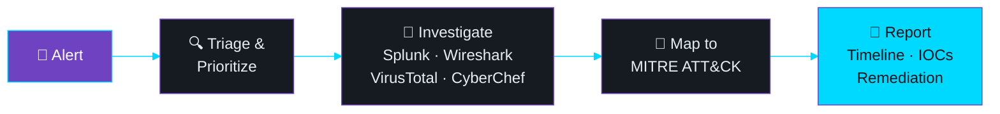

<div align="center">


<br/>

<a href="https://tryhackme.com/p/ENGZOOZ"></a>
<a href="https://www.linkedin.com/in/engzooz/"></a>
<a href="mailto:ziad.ayman.shokry@gmail.com"></a>


</div>

<br/>


<div align="center">

</div>

```bash
ziad@soc-lab:~$ whoami
Ziad Ayman | 3rd-year Computer Science @ Minya National University (Class of 2028)

ziad@soc-lab:~$ cat mission.txt
Detect. Triage. Investigate. Respond. Document everything. Prove everything.

ziad@soc-lab:~$ cat status.txt
role     : Aspiring SOC Analyst / Blue Team
looking  : SOC Analyst / Cybersecurity internship
ranking  : Top 1% worldwide on TryHackMe
building : Microsoft Sentinel | Active Directory Lab | Sysmon & Detection Engineering
```

> 💡 I don't just collect certificates. I build proof: hands-on labs, documented investigations, and real SOC simulations that show *how* I think, not just *what* I studied.


<div align="center">


<br/>


<br/>


<br/>


<sub>MTTR: 1 minute vs. 4-minute TryHackMe platform average</sub>

</div>


<div align="center">

</div>



<table width="100%">
<tr>
<td width="33%" valign="top">

### 🔍 Detect
- Alert triage & prioritization
- Brute-force & SYN/FIN scan detection
- Suspicious DNS / DNS tunneling analysis
- HTTP credential exposure detection

</td>
<td width="33%" valign="top">

### 🧠 Analyze
- Splunk SPL, dashboards & event correlation
- Deep packet inspection (Wireshark)
- Nmap: OS fingerprinting, NSE, stealth scans
- VirusTotal · CyberChef · Event Viewer

</td>
<td width="33%" valign="top">

### 📝 Respond & Report
- End-to-end phishing investigation
- MITRE ATT&CK technique mapping
- Attack timelines & IOC extraction
- Remediation recommendations

</td>
</tr>
</table>


<div align="center">

</div>

### 🎣 Phishing Unfolding: SOC Simulation

Full investigation on the **TryHackMe SOC Simulator**: **35 alerts closed, 100% true positive rate, 9-minute dwell time**.

```mermaid
%%{init: {'theme':'base','themeVariables':{'primaryColor':'#161b22','primaryTextColor':'#e6edf3','primaryBorderColor':'#6f42c1','lineColor':'#00d9ff','fontFamily':'monospace'}}}%%
flowchart LR
    P["🎣 Phishing<br/>Email"] --> S["💥 System<br/>Compromise"]
    S --> T["🔑 T1003<br/>Credential Dumping"]
    T --> X["📤 Data<br/>Exfiltration"]
    style P fill:#161b22,stroke:#6f42c1
    style T fill:#6f42c1,color:#fff,stroke:#00d9ff
    style X fill:#161b22,stroke:#00d9ff
```



Traced the attack end to end using SIEM logs and delivered a full report: **timeline, IOCs, MITRE ATT&CK mapping, remediation.**

`Incident Response` `MITRE ATT&CK` `SIEM` `T1003`

<br/>

<table width="100%">
<tr>
<td width="50%" valign="top">

### 🕵️ SOC Simulator: 90 Alerts
5 full SOC scenarios completed end to end.

- **90 alerts** triaged, **100% true positive**
- **1-minute MTTR** (platform avg: 4 min)
- Findings mapped to **MITRE ATT&CK**

`Alert Triage` `Threat Detection` `MITRE ATT&CK`

</td>
<td width="50%" valign="top">

### 📊 SOC Log Analysis & Recon Lab
**Splunk** in a virtual Linux environment.

- Brute-force pattern analysis
- Custom **dashboards** to triage high-risk events
- **Nmap** sweeps correlated with firewall **PCAPs** to detect SYN/FIN scanning

`Splunk` `Nmap` `Wireshark` `SIEM`

</td>
</tr>
<tr>
<td width="50%" valign="top">

### 💻 Competitive Programming Framework
Modular **C++** templates for graphs, trees and DP, built for contest speed.

- **2,300+ problems** solved on Codeforces & HackerRank

`C++` `Python` `Algorithms` `Data Structures`

</td>
<td width="50%" valign="top">

### 🐧 OverTheWire Bandit: 34/34
Linux command line, SSH, file system navigation and security fundamentals, all levels completed.

`Linux` `SSH` `Bash`

</td>
</tr>
</table>

> 👉 Full repositories & writeups: **[github.com/engzooz?tab=repositories](https://github.com/engzooz?tab=repositories)**

<details>
<summary><b>📖 Latest Writeups (click to expand)</b></summary>
<br/>

- 📌 Phishing Unfolding: SOC Investigation
- 📌 Credential Dumping (T1003) Detection
- 📌 DNS Tunneling Investigation
- 📌 HTTP Credential Capture via Wireshark
- 📌 Nmap Stealth Scan Enumeration
- 📌 OverTheWire Bandit (All 34 Levels)
- 📌 Splunk Brute-Force Detection Dashboard
- 📌 Malicious Artifact Analysis via CyberChef

</details>


<div align="center">


<br/>


<br/><br/>


</div>


<div align="center">

</div>



<div align="center">

```mermaid
%%{init: {'theme':'base','themeVariables':{'primaryColor':'#161b22','primaryTextColor':'#e6edf3','primaryBorderColor':'#6f42c1','lineColor':'#00d9ff','fontFamily':'monospace'}}}%%
flowchart LR
    A["✅ Cisco &<br/>IBM Foundations"] --> B["✅ Fortinet NSE 3<br/>Huawei Net Security"]
    B --> C["✅ Cisco Defense<br/>Analyst Pathway"]
    C --> D["✅ TryHackMe Top 1%<br/>SOC Simulator · Splunk"]
    D --> E["🔄 Microsoft<br/>Sentinel"]
    E --> F["🔄 Active Directory<br/>Lab"]
    F --> G["🔄 Sysmon +<br/>Detection Eng."]
    G --> H["🎯 SOC Analyst /<br/>Threat Hunter"]
    style A fill:#161b22,stroke:#2ea44f
    style B fill:#161b22,stroke:#2ea44f
    style C fill:#161b22,stroke:#2ea44f
    style D fill:#161b22,stroke:#2ea44f
    style E fill:#161b22,stroke:#00d9ff
    style F fill:#161b22,stroke:#00d9ff
    style G fill:#161b22,stroke:#00d9ff
    style H fill:#6f42c1,color:#fff,stroke:#00d9ff
```

**Currently learning**


</div>


<div align="center">

</div>

| Certification | Provider | Date |
|---|---|---|
| 🎯 Cybersecurity Defense Analyst Pathway Exam | Cisco Networking Academy | Sep 2026 |
| 🌐 Network Security | Huawei ICT Academy | Sep 2026 |
| 🛡️ NSE 3: Certified in Cybersecurity *(valid until Sep 2028)* | Fortinet | Aug 2026 |
| 🎯 Certified Cybersecurity Foundations (CORE) | Hackviser | Jul 2026 |
| 🔎 Foundation Level Threat Intelligence Analyst (CTI 101) | ARCX | Jun 2026 |
| ☁️ Introduction to the Threat Landscape 3.0 | Fortinet Training Institute | Jun 2026 |
| 🐧 Ubuntu Linux Essentials | ITI | Apr 2026 |
| 🔐 Cybersecurity Fundamentals *(Credly Verified)* | IBM SkillsBuild | Mar 2026 |
| 💻 Introduction to Cybersecurity | Cisco Networking Academy | Nov 2025 |

<details>
<summary><b>＋ More certifications</b></summary>
<br/>

- 🔒 Introduction to Cybersecurity Awareness: HP LIFE (Mar 2025)
- 🧩 Problem Solving (Intermediate), C# (Basic): HackerRank (May 2025)
- 🤖 AI Literacy: MCIT & Microsoft (Jun 2026)
- 🐍 Python Programming Basics & Learn HTML/CSS: ITI (Oct 2025)

</details>


<div align="center">

</div>

**🧑‍🏫 Technical Mentor & Problem Setter** | *ICPC MNU Community* | 2024 – Present
Mentoring peers in data structures, algorithms and programming paradigms; designing and verifying contest problems with comprehensive edge-case test suites.

**🛡️ Cybersecurity Hands-on Labs & SOC Simulations** | *TryHackMe, Self-Driven* | 2025 – Present
Top 1% globally · 200+ rooms · 30+ badges (Advent of Cyber 2022, 2023, 2024 · Hacker Holidays 2026).

**Awards**
- 🏆 **Learner Achievement Award**: Cisco Networking Academy Learn-A-Thon 2026 (Mar 2026)
- 🥉 **Honorable Mention**: ECPC Qualifications, ICPC Egyptian Collegiate Programming Contest (Aug 2025)

**🎓 Education:** B.Sc. in Computer Science, Minya National University *(Expected 2028)*
Network Security · Operating Systems · Data Structures · Algorithms · Discrete Structures

**🌍 Languages:** Arabic (Native) · English (Intermediate, B1)


<div align="center">


<br/>

<picture>
  <source media="(prefers-color-scheme: dark)" srcset="https://raw.githubusercontent.com/engzooz/engzooz/output/github-contribution-grid-snake-dark.svg" />
  <source media="(prefers-color-scheme: light)" srcset="https://raw.githubusercontent.com/engzooz/engzooz/output/github-contribution-grid-snake.svg" />
  
</picture>

<br/><br/>


<br/>


<br/>


</div>


<div align="center">


<br/>

### Looking for a SOC Analyst intern who closes alerts fast and documents everything? Let's talk.

<a href="mailto:ziad.ayman.shokry@gmail.com"></a>
<a href="https://www.linkedin.com/in/engzooz/"></a>
<a href="https://tryhackme.com/p/ENGZOOZ"></a>

<br/>

> *"Security is not about preventing every attack. It's about detecting, understanding, and responding faster than the attacker."*


</div>
